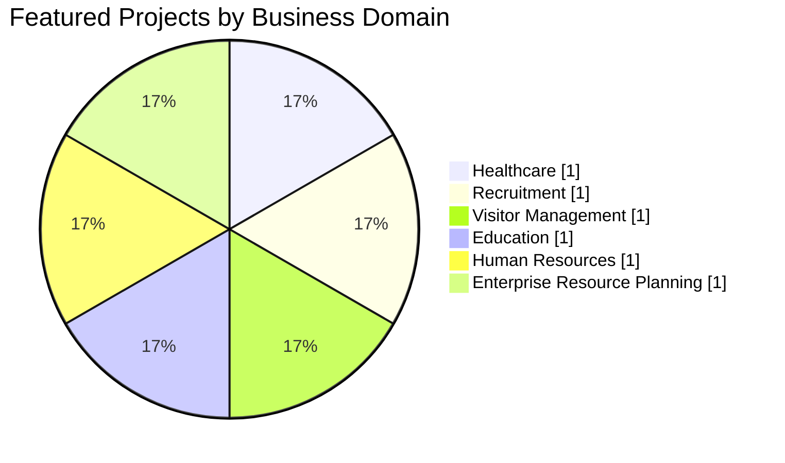

\<!--
CHANDAN TR | BUSINESS ANALYST PORTFOLIO
Repository: chandantr250/chandantr250
\-->

\

\<!-- Upload your custom banner to assets/chandan-banner.png and uncomment this image -->

\<!-- \ -->

# CHANDAN TR

### BUSINESS ANALYST · REQUIREMENTS ENGINEERING · BUSINESS PROCESS ANALYSIS

**Turning business requirements into structured workflows and practical technology solutions.**

\ 

\<a href="[https://chandantr.netlify.app/](https://chandantr.netlify.app/)">
&#x20; \
\</a>
\<a href="[https://www.linkedin.com/in/chandan-chandu-/](https://www.linkedin.com/in/chandan-chandu-/)">
&#x20; \
\</a>
\<a href="mailto\:chandantr16\@gmail.com">
&#x20; \
\</a>
\<a href="[https://github.com/chandantr250](https://github.com/chandantr250)">
&#x20; \
\</a>

📍 Bengaluru, Karnataka, India

\

---

## 01 / PROFILE

I'm a **Business Analyst at iLogitek Business Solutions Pvt. Ltd.**, with an MBA background in Human Resource Management and Business Analytics.

I specialize in understanding business needs, translating them into functional requirements, documenting workflows, and coordinating with cross-functional teams to support software development.

My approach combines business understanding, analytical thinking, structured documentation, and effective communication.

\<table>
\<tr>
\<td width="50%" valign="top">

**BUSINESS ANALYSIS**

- Requirement gathering
- BRD and FRD documentation
- Business process analysis
- Gap and competitor analysis
- User stories and acceptance criteria
- Workflow documentation

\</td>
\<td width="50%" valign="top">

**PROJECT COORDINATION**

- Stakeholder communication
- Developer coordination
- UI/UX review coordination
- QA and testing follow-ups
- UAT support
- Project tracking

\</td>
\</tr>
\</table>

---

## 02 / SKILLS & TECHNOLOGY

**Business Analysis**

\

**Data & Technical Skills**

\

**API Testing:** GET · POST · PATCH · DELETE

**Tools & Platforms**

\

**Business Applications:** HRMS · CRM · ERP · HMS · VMS · Job Portals

---

## 03 / FEATURED PROJECTS

Selected business analysis and software documentation projects.

\<table>
\<tr>
\<td width="50%" valign="top">

### 🏥 Hospital Management System

**Domain:** Healthcare

- Patient and doctor management
- Appointment workflows
- OPD and IPD
- Billing and payments
- Pharmacy and laboratory
- Optional housekeeping
- Optional HR and payroll

**My Role:** BRD/FRD preparation, business requirements, functional specifications, and process documentation.

\<a href="[https://github.com/chandantr250/Hospital-Management-System](https://github.com/chandantr250/Hospital-Management-System)">
&#x20; \
\</a>

\</td>
\<td width="50%" valign="top">

### 💼 Hirenza – Job Portal

**Domain:** Recruitment Technology

- Employer management
- Job seeker management
- Job posting and applications
- Role-based panels
- Recruitment workflows
- Mobile job seeker requirements

**My Role:** Requirement gathering, BRD/FRD documentation, developer coordination, and testing follow-ups.

\<a href="[https://github.com/chandantr250/hirenza-job-portal](https://github.com/chandantr250/hirenza-job-portal)">
&#x20; \
\</a>

\</td>
\</tr>
\<tr>
\<td width="50%" valign="top">

### 🏢 Visitor Management System

**Domain:** Enterprise Solutions

- Visitor registration
- Check-in and check-out
- Host approval workflows
- QR-based check-in
- Visitor pass generation
- Notifications and reports
- Role-based access

**My Role:** BRD/FRD preparation, workflow definition, and developer coordination.

\<a href="[https://github.com/chandantr250/Visitor-Management-System-](https://github.com/chandantr250/Visitor-Management-System-)">
&#x20; \
\</a>

\</td>
\<td width="50%" valign="top">

### 🎓 School Management System

**Domain:** Education Technology

- School administration
- Student and staff management
- Module and workflow documentation
- Competitor analysis
- Gap analysis
- Functional specifications
- Backend development scope

**My Role:** Business analysis, requirements documentation, competitor research, and gap analysis.

\<a href="[https://github.com/chandantr250/School-Management-System-](https://github.com/chandantr250/School-Management-System-)">   \ \</a>

\</td> \</tr> \<tr> \<td width="50%" valign="top">

### 👥 HRMS Requirements

**Domain:** Human Resource Technology

- HRMS business requirements
- Competitor comparison
- Gap analysis
- Project management module documentation

**My Role:** Requirement analysis, functional documentation, and competitor analysis.

\<a href="[https://github.com/chandantr250/HRMS-Requirements](https://github.com/chandantr250/HRMS-Requirements)">
&#x20; \
\</a>

\</td>
\<td width="50%" valign="top">

### 📊 ERP Business Analysis

**Domain:** Enterprise Resource Planning

- ERP strategic recommendations
- CRM product requirements
- Business management workflows
- Integrated platform planning

**My Role:** Business analysis, requirement planning, and product documentation.

\<a href="[https://github.com/chandantr250/ERP-Business-Analysis](https://github.com/chandantr250/ERP-Business-Analysis)">   \ \</a>

\</td> \</tr> \</table>

---

## 04 / PROJECT PORTFOLIO ANALYSIS

The chart below shows the distribution of the six featured repositories by their primary business domain. Each repository is counted once.

---

## 05 / PROFESSIONAL EXPERIENCE

### Business Analyst

**iLogitek Business Solutions Pvt. Ltd.** · Bengaluru

`June 2026 – Present`

- Gather and analyze business requirements for software projects.
- Prepare Business Requirement Documents (BRD) and Functional Requirement Documents (FRD).
- Define functional requirements, workflows, and business processes.
- Coordinate with developers, UI/UX designers, QA teams, and stakeholders.
- Maintain project trackers and monitor development progress.
- Support requirement validation and testing follow-ups.
- Identify process gaps and document improvement opportunities.
- Work across HRMS, ERP, HMS, VMS, and job portal solutions.

### HR Intern

**Hilton & Hilton Garden Inn** · Embassy Manyata Business Park, Bengaluru

`December 2024 – February 2025`

- Supported HR operations and employee engagement activities.
- Prepared engagement reports covering 100+ employees.
- Performed Excel-based data validation and reporting.
- Assisted with onboarding documentation and HR processes.

---

## 06 / EDUCATION

**MASTER OF BUSINESS ADMINISTRATION**

Human Resource Management & Business Analytics
CMR University, Bengaluru · Completed 2026

**BACHELOR OF BUSINESS ADMINISTRATION**

Completed January 2025

---

## 07 / LANGUAGES

- English

---

## 08 / CAREER DIRECTION

I aim to grow as a Business Analyst by continuously strengthening my analytical, technical, and problem-solving capabilities while contributing to meaningful technology-driven business solutions.

**Areas of interest**

`Business Analysis` · `Business Systems Analysis` · `Requirements Engineering` · `Business Process Analysis` · `Enterprise Software Solutions`

---

## 09 / LET'S CONNECT

\

### HAVE A PROJECT OR OPPORTUNITY?

I'm open to connecting with professionals, collaborating on business analysis projects, and exploring relevant Business Analyst opportunities.

\<a href="[https://chandantr.netlify.app/](https://chandantr.netlify.app/)">   \ \</a> \<a href="[https://www.linkedin.com/in/chandan-chandu-/](https://www.linkedin.com/in/chandan-chandu-/)">   \ \</a> \<a href="mailto\:chandantr16\@gmail.com">   \ \</a>

\ \ 

**Thank you for visiting my profile.**

*Business Analysis · Structured Thinking · Practical Solutions*

\

